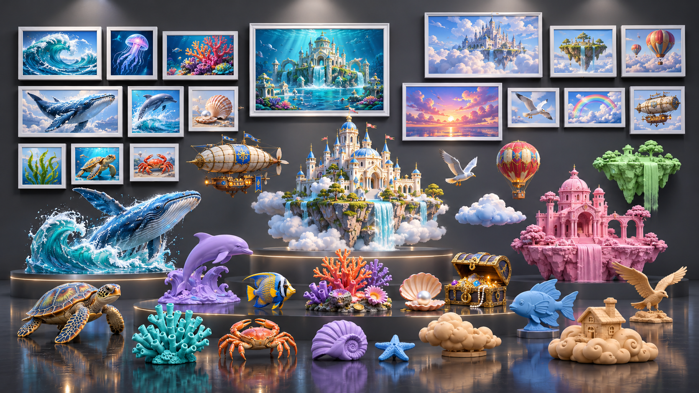

<div align="center">

# BlueFox3D 1.0

Image-to-3D generation with pixel-aligned geometry and PBR textures.

</div>

<div align="center">
    
</div>

**BlueFox3D** generates high-fidelity 3D assets from a single image (or posed multi-view images). It lifts pixel features into 3D through back-projection so the mesh stays aligned with the input.

Weights are hosted on Hugging Face at [`Hydrilla/BlueFox3D`](https://huggingface.co/Hydrilla/BlueFox3D). They download automatically on first run into `~/.cache/huggingface/hub/`.

This repository is inference and training **Python code only**. It does **not** compile FlexGEMM, o_voxel, or flash-attn. Install [TRELLIS.2](https://github.com/microsoft/TRELLIS.2) first and use that environment.

---

## Clone and run

### 1. Clone this repo

```bash
git clone https://github.com/HydrillaAI/Bluefox3D.git BlueFox3D1.0
cd BlueFox3D1.0
```

### 2. Install TRELLIS.2 first

Follow the [TRELLIS.2 installation guide](https://github.com/microsoft/TRELLIS.2) and activate that environment. BlueFox3D imports the CUDA extensions already built there (FlexGEMM, o_voxel, flash-attn, nvdiffrast).

### 3. Install BlueFox3D dependencies

```bash
pip install -r requirements.txt
```

Install natten (replace `xx` with your GPU CUDA architecture and worker count):

```bash
NATTEN_CUDA_ARCH="xx" NATTEN_N_WORKERS=xx pip install natten==0.21.0 --no-build-isolation
```

Install utils3d:

```bash
pip install https://github.com/LDYang694/Storages/releases/download/20260430/utils3d-0.0.2-py3-none-any.whl
```

### 4. Pin `huggingface_hub` (do not upgrade to 1.x)

`transformers==4.57.3` in this repo requires Hub 0.x:

```bash
pip install "huggingface_hub>=0.34,<1.0"
```

Do **not** run `pip install -U huggingface_hub`. Hub 1.x breaks this stack.

### 5. Run inference

```bash
python inference.py --image assets/images/1_img.png --output ./output.glb --low_vram --resolution 1536
```

Presets (same weights; only crop save, mesh cleanup, and steps/resolution change):

```bash
# Pixal3D-equivalent defaults
python inference.py --image assets/images/1_img.png --output ./output.glb --low_vram --preset baseline --resolution 1536

# Wrapper: island drop + light smooth, 1536, 12 steps
python inference.py --image assets/images/1_img.png --output ./output.glb --low_vram --preset quality

# Wrapper: same cleanup, 1024, 8 steps
python inference.py --image assets/images/1_img.png --output ./output.glb --low_vram --preset fast
```

`--decimation`, `--texture-size`, `--cleanup`, `--save-preprocessed`, and `--render-stills` are also available. `--low_vram` is required on 24 GB GPUs (L4 and similar). First run downloads [`Hydrilla/BlueFox3D`](https://huggingface.co/Hydrilla/BlueFox3D) plus DINOv3 / MoGe / rembg into `~/.cache/huggingface/hub/`.

If `flash_attn` is not available, use PyTorch SDPA:

```bash
ATTN_BACKEND=sdpa python inference.py --image assets/images/1_img.png --output ./output.glb --low_vram --resolution 1536
```

Override the checkpoint with `BLUEFOX3D_MODEL` or `--model_path`. Default remains [`Hydrilla/BlueFox3D`](https://huggingface.co/Hydrilla/BlueFox3D). Optional 4-stage last-4-block character cascade (not a replacement): [`Hydrilla/BlueFox3D-retrained-characters`](https://huggingface.co/Hydrilla/BlueFox3D-retrained-characters) ([COMPARE_RETRAINED_CHARACTERS.md](COMPARE_RETRAINED_CHARACTERS.md)).

> `requirements-hfdemo.txt` is for the Hugging Face Spaces demo (H-series GPUs) and may not match other architectures.

---

## Package

| | |
|---|---|
| Default weights | [`Hydrilla/BlueFox3D`](https://huggingface.co/Hydrilla/BlueFox3D) |
| Optional 4-stage character pack | [`Hydrilla/BlueFox3D-retrained-characters`](https://huggingface.co/Hydrilla/BlueFox3D-retrained-characters) (not a replacement) |
| Env override | `BLUEFOX3D_MODEL` |
| Config | `bluefox3d/config.py` → `DEFAULT_MODEL_PATH` |
| Pipelines | `BlueFox3DImageTo3DPipeline`, `BlueFox3DMVImageTo3DPipeline` |

---

## Multi-view inference

When you have several views of the same object:

```bash
python inference_mv.py --views_dir assets/mv_images/example --output ./output_mv.glb --low_vram
```

Put images plus a `transforms.json` in that directory (Blender/NeRF camera-to-world, Z-up). `--low_vram`, `--resolution`, and `ATTN_BACKEND` work the same as single-image inference. `--num_views N` uses only the first N views.

Shipped example views: `assets/mv_images/example/` (four posed PNGs + `transforms.json`). There is no one-photo orbit synthesis; you need cameras.

If your views are a 90° orbit at eye level, reuse `assets/mv_images/example/transforms.json` and point each `file_path` at your images. The first frame should be the front view.

---

## Web demo

```bash
python app.py --low_vram
```

Or `LOW_VRAM=1 python app.py`. The UI defaults to 1024 in low-VRAM mode (1536 otherwise).

---

## Training

The training codebase and `data_toolkit/` are included. Prepare view-aligned O-Voxel data by following [data_toolkit/README.md](data_toolkit/README.md).

BlueFox3D is a three-stage cascade (sparse structure → shape → texture). Start from the lowest resolution in each stage and raise it with `finetune_ckpt` in the config.

```sh
python train.py \
  --config <CONFIG_JSON> \
  --output_dir <OUTPUT_DIR> \
  --data_dir '<DATA_DIR_JSON>'
```

`--data_dir` is a JSON string. Sparse structure needs `base`, `ss_latent`, `render_cond`; shape needs `base`, `shape_latent`, `render_cond`; texture needs `base`, `shape_latent`, `pbr_latent`, `render_cond`. Example configs live in `configs/gen/`.

The 4-stage L4 character cascade (SS-64, shape-512, shape-1024, tex-1024 on an Objaverse-LVIS subset, last 4 blocks, 1000 steps) is documented in [COMPARE_RETRAINED_CHARACTERS.md](COMPARE_RETRAINED_CHARACTERS.md) (`data_toolkit/run_character_cascade.sh`). It is not a general quality upgrade over [`Hydrilla/BlueFox3D`](https://huggingface.co/Hydrilla/BlueFox3D), which remains the recommended default checkpoint.

---

## Model Cards & Benchmarks

### 1. Open-Weights 15-Image Benchmark (Single NVIDIA L4, 24 GB VRAM, Seed 42)

Measured directly from generated GLBs and run metadata on a single NVIDIA L4 (`g2-standard-8`, 24 GB VRAM) across 15 diverse images from `assets/images/` (objects, characters, scenes/dioramas):

| Model | Checkpoint / Source | Completed | Avg Time / Asset | Avg Vertices | Avg Faces | Avg GLB Size | Output Type |
|---|---|---:|---:|---:|---:|---:|---|
| **BlueFox3D (Stock)** | [`Hydrilla/BlueFox3D`](https://huggingface.co/Hydrilla/BlueFox3D) | 15 / 15 | 4.2 min (254 s) | 199,836 | 214,576 | 11.3 MB | 2048 PBR maps |
| **BlueFox3D (Char Pack)** | [`Hydrilla/BlueFox3D-retrained-characters`](https://huggingface.co/Hydrilla/BlueFox3D-retrained-characters) | 15 / 15 | 4.4 min (266 s) | 203,623 | 214,524 | 11.7 MB | 2048 PBR maps |
| **TRELLIS.2-4B** | `microsoft/TRELLIS.2-4B` | 15 / 15 | 9.4 min (564 s) | 219,553 | 239,819 | 19.7 MB | 2048 PBR maps |
| **Hunyuan3D-2.1** | `tencent/Hunyuan3D-2.1` | 15 / 15 | 11.8 min (709 s) | 31,939 | 40,000 | 6.2 MB | Painted mesh (40k remesh) |
| **Hi3DGen** | `Stable-X/trellis-normal-v0-1` | 15 / 15 | 1.5 min (88 s) | 426,673 | 853,476 | 19.5 MB | Clay mesh (no PBR) |

**Methodology & observed trade-offs (no uncomputed Chamfer/CLIP/FID scores):**
- **Timing caveats:** BlueFox3D timings reflect `--low_vram` CPU↔GPU stage swapping in warm sequential runs (~4.2–4.4 min/asset; cold single-image CLI runs including model load take ~6–9 min). Hunyuan3D-2.1 averaged 11.8 min/asset in this 5-model batch (3.9 min/asset in an earlier warm 4-model run). Hi3DGen is fastest because it outputs untextured clay geometry with no decimation.
- **BlueFox3D (Stock):** Recommended default. Preserves input color fidelity on stylized props/characters (`7_img`, `9_img`) with 2048 PBR maps; observed failure modes include an unprompted staff on `21_img`, a base slab on `5_img`, and rug fragments on `s_18_img`.
- **BlueFox3D (Char Pack):** Very close to stock on most of the 15 images, reproduces the `21_img` / `5_img` artifacts, and fragmented worse in the isolated `21_img` test.
- **TRELLIS.2-4B:** Strong geometry and 2048 PBR maps, with larger GLBs (19.7 MB avg) and ~2.2× slower runtime than BlueFox3D on a 24 GB L4.
- **Hunyuan3D-2.1:** Lightest GLBs (40k faces, 6.2 MB avg); failed on `s_15_img` (invented a large table disc), lost scene objects to background removal on `s_18_img`, and shifted colors on `7_img` / `9_img`.
- **Hi3DGen:** Sharpest clay geometry (`853,476` avg faces) and fastest runtime, but outputs no PBR textures (requires a separate texturing pipeline).

### 2. BlueFox3D Checkpoints Compared

| Repo | What Changed | `21_img.png` (Seed 42, 1536 `--low_vram`) | Status |
|---|---|---|---|
| [`Hydrilla/BlueFox3D`](https://huggingface.co/Hydrilla/BlueFox3D) | Stock Pixal3D / TRELLIS.2-architecture 1.3B 3-stage cascade | 211,389 verts, 246,891 faces, 14.0 MB, 376 s | **Recommended default** |
| [`Hydrilla/BlueFox3D-retrained-characters`](https://huggingface.co/Hydrilla/BlueFox3D-retrained-characters) | 4-stage L4 pack (SS-64, shape-512, shape-1024, tex-1024 last-4-block finetune) | 197,039 verts, 236,397 faces, 13.2 MB, 396 s (more fragmented on `21_img`) | Experimental |

### Docs & Cards

- Base Hugging Face card source: [hf_bluefox3d_README.md](hf_bluefox3d_README.md) ([`Hydrilla/BlueFox3D`](https://huggingface.co/Hydrilla/BlueFox3D))
- Character 4-stage pack card source: [hf_retrained_characters_README.md](hf_retrained_characters_README.md) ([`Hydrilla/BlueFox3D-retrained-characters`](https://huggingface.co/Hydrilla/BlueFox3D-retrained-characters))
- Cascade evaluation: [COMPARE_RETRAINED_CHARACTERS.md](COMPARE_RETRAINED_CHARACTERS.md)

---

## Acknowledgements

BlueFox3D builds on [TRELLIS.2](https://github.com/microsoft/TRELLIS.2), [Direct3D-S2](https://github.com/DreamTechAI/Direct3D-S2), [Trellis](https://github.com/microsoft/TRELLIS), and [MoGe](https://github.com/microsoft/MoGe). Required upstream attribution is in [NOTICE](NOTICE).

```bibtex
@article{li2026pixal3d,
    title={Pixal3D: Pixel-Aligned 3D Generation from Images},
    author={Li, Dong-Yang and Zhao, Wang and Chen, Yuxin and Hu, Wenbo and Guo, Meng-Hao and Zhang, Fang-Lue and Shan, Ying and Hu, Shi-Min},
    journal={arXiv preprint arXiv:2605.10922},
    year={2026}
}
```

## License

This project is released under the [MIT License](LICENSE). Third-party components remain under their original terms; see [NOTICE](NOTICE).
